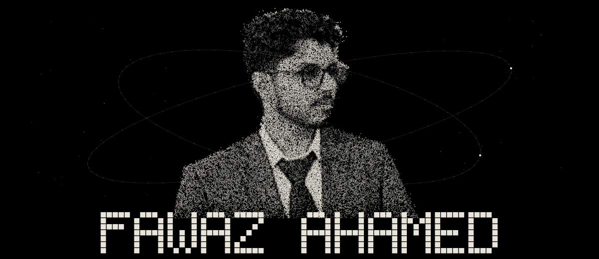

# Fawaz Ahamed

I'm a student at VIT Chennai, building Symmet, AI design and visualization for big furniture showroom chains that have their own design teams. The hard part is distribution, not tech. I also build AI agents, agent memory, RAG and automation, hack on open-source agent infra (MCP, cognee, mem0, composio, CopilotKit), and work on robotics: drones, RL and Simulink.

## Cooking...

- [Symmet](https://symmet.in): AI visualization for furniture showrooms.
- [sarvam-editor](https://github.com/boss477/sarvam-editor): An open-source AI video editor for Indian creators, built on OpenCut Classic. It adds Sarvam AI captions, translation, dubbing and agent controls.
- [NexusRAG](https://github.com/boss477/NexusRAG): A production-oriented agentic, corrective, multimodal RAG pipeline with LangGraph multi-agent orchestration, hybrid dense and sparse retrieval on Qdrant, web fallback for corrective retrieval, FastAPI, RAGAS evals and LangSmith tracing. I'm building it as a 30-day project, one tested slice a day.
- [drone-disaster-rescue-simulation](https://github.com/boss477/drone-disaster-rescue-simulation): A simulation-only flood rescue toolkit with a zero-shot CLIP disaster image classifier and a 3D rescue simulation with drone and package drops. It also has a live disaster ops map on OpenStreetMap with weather and active incidents, and streams MAVLink telemetry into QGroundControl (SITL only).
- [digup-windows](https://github.com/boss477/digup-windows): Native Windows search in Rust that finds files by what they mean, not just their name. It covers filenames, documents (PDF, DOCX and more) and OCR, with optional local semantic search using embeddings.
- [HippocampAI](https://github.com/boss477/HippocampAI): An agentic memory engine that gives AI assistants persistent, human-like recall, with a portable encrypted BrainVault that lives on USB storage. It was a team project, and we won 1st Runner-Up (Rs 50,000) at the SanDisk Hackathon in Vellore, out of 1000+ teams.
- [TraceBrain](https://github.com/boss477/graphhacks): A company-memory assistant built for Graph Hacks 2026 on FastAPI and FalkorDB, [live here](https://tracebrain.onrender.com/). Answers come with sources, the exact Cypher query, the graph path, freshness and conflict warnings, plus agent-to-agent handoffs.
- [AI-GTM](https://github.com/boss477/AI-GTM): A GTM strategy workbench that turns market signals into research, a campaign plan from a strategist agent, approval gates and tool execution.

## Talk to me

I want to talk to people who sell into furniture showrooms or work on distribution, and to anyone building agent tooling. Email me at fawaz0212kb@gmail.com or find me on [LinkedIn](https://www.linkedin.com/in/fawaz-ah).

---

<picture>
  <source media="(prefers-color-scheme: dark)" srcset="https://raw.githubusercontent.com/boss477/boss477/output/github-snake-dark.svg">
  <source media="(prefers-color-scheme: light)" srcset="https://raw.githubusercontent.com/boss477/boss477/output/github-snake.svg">
  
</picture>

<picture>
  <source media="(prefers-color-scheme: dark)" srcset="https://raw.githubusercontent.com/boss477/boss477/output/pacman-contribution-graph-dark.svg">
  <source media="(prefers-color-scheme: light)" srcset="https://raw.githubusercontent.com/boss477/boss477/output/pacman-contribution-graph.svg">
  
</picture>
